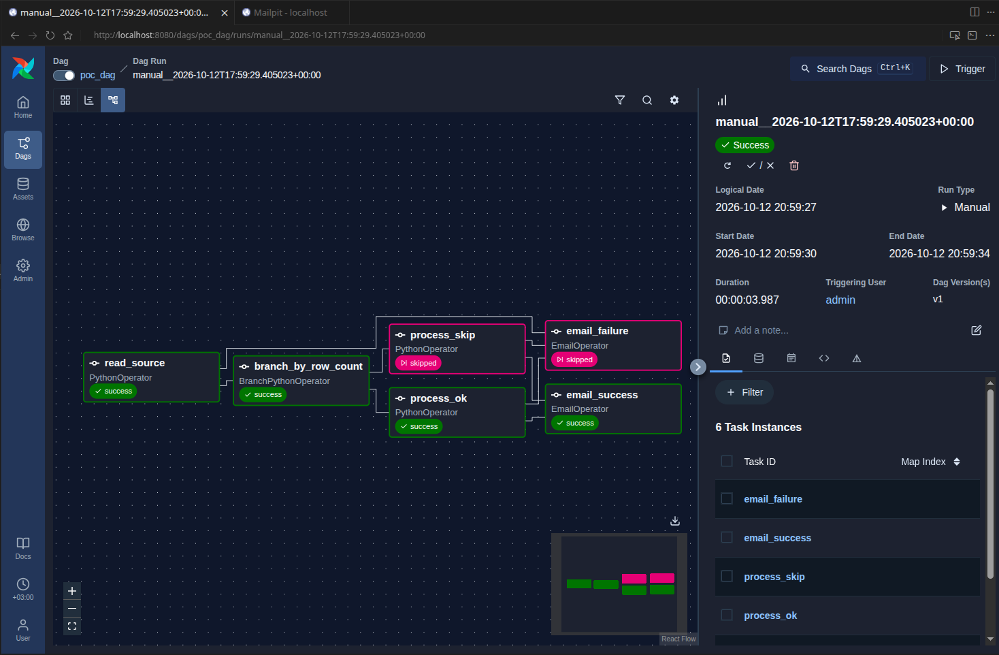
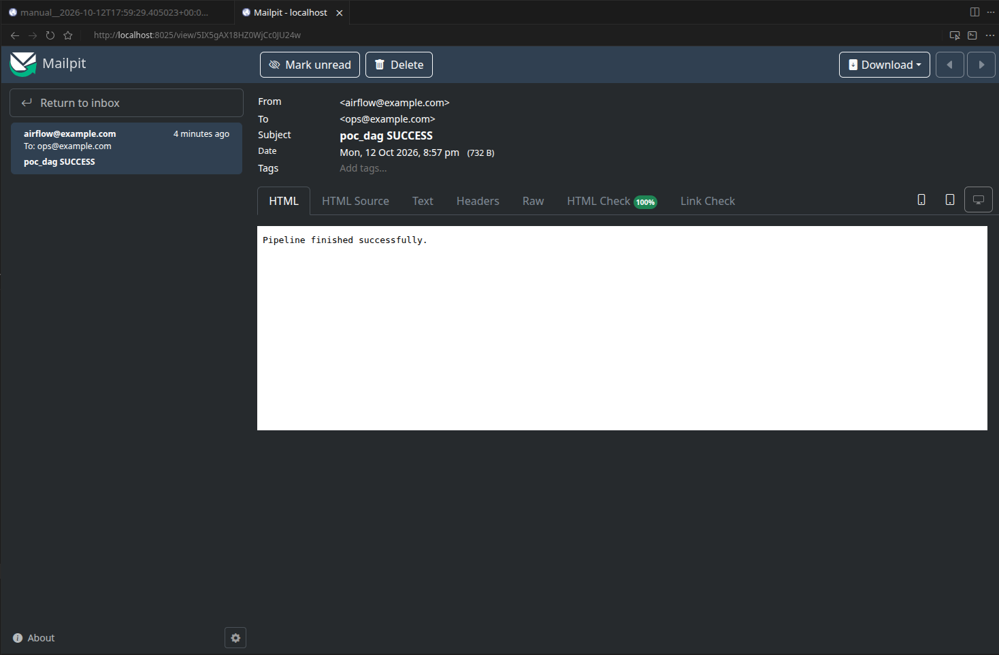

# Задание 1. Выбор и реализация решения для пакетной обработки данных

## Выбор решения

Выбран **Apache Airflow**, т.к. нужна сложная логика, ветвления, интеграции с различными источниками
и встроенными повторениями и уведомлениями.

### Интеграции

| Система  | Готовые модули                                                                                                                 |
| -------- | ------------------------------------------------------------------------------------------------------------------------------ |
| BigQuery | https://airflow.apache.org/docs/apache-airflow-providers-google/stable/_api/airflow/providers/google/cloud/operators/bigquery/ |
| Redshift | https://airflow.apache.org/docs/apache-airflow-providers-amazon/stable//index.html                                             |
| Kafka    | https://airflow.apache.org/docs/apache-airflow-providers-apache-kafka/stable/index.html                                        |
| Spark    | https://airflow.apache.org/docs/apache-airflow-providers-google/stable/operators/cloud/dataproc.html                           |

### Функционал

- Ветвление - `BranchPythonOperator`
- Условные пути и trigger rules есть из коробки
- Event-triggers - sensors или HTTP API `dagRuns` (`schedule=None`)

### Fallback

- `retries`, `retry_delay`, `retry_exponential_backoff` для task
- `on_failure_callback` / `EmailOperator` для уведомлений
- Fallback через ветки DAG и trigger rules (`one_failed`, `none_failed_min_one_success`)

### Облачная среда

Локально через Docker Compose, а в облаке можно развернуть в Docker Swarm или Kubernetes.

## POC (Proof of Concept)

`poc_dag`:

1. `read_source` - чтение CSV (`data/orders.csv`)
2. `branch_by_row_count` - ветка: >= 3 строк -> `process_ok`, иначе `process_skip`
3. `email_success` / `email_failure` - письма через Mailpit

### Запуск

```bash
make up
```

- Airflow UI: http://localhost:8080
- Mailpit UI: http://localhost:8025

Остановка:

```bash
make down
```

### Скриншоты




