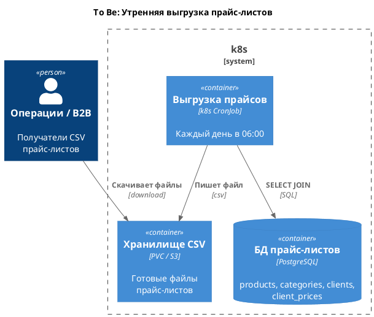

# Задание 2. Разработка дизайна модуля пакетной обработки данных

## Сравнение

|                                                                                       | Spring Batch                          | Apache Airflow              | K8s CronJob                    | Spark                            |
| ------------------------------------------------------------------------------------- | ------------------------------------- | --------------------------- | ------------------------------ | -------------------------------- |
| Наличие конфигурации CRON-расписания                                                  | + Через Quartz/Scheduler/внешний Cron | + Да (`schedule`)           | + Да (`schedule` в CronJob)    | - Нет, нужен внешний оркестратор |
| Сложность реализации логики по обработке данных                                       | - Средняя, описывать Job/Step         | - Лишняя для простых задач  | + Просто: SQL + CSV            | - Сложно для малого объёма       |
| Ресурсоёмкость решения (количество потребляемых ресурсов)                             | - Требует JVM и БД                    | - Scheduler, workers, БД    | + Один pod на задачу           | - Кластер воркеров               |
| Масштабируемость решения под нагрузкой и сложность реализации                         | + Есть, если надо партиционировать    | - Масштабируется, но сложно | + Масштаб по pod (CPU/память)  | - Кластер, не оправдан           |
| Сложность развёртывания в облаке и интеграция с имеющейся микросервисной архитектурой | + Образ и БД метаданных               | - Нужен отдельный стек      | + Уже часть k8s                | - Отдельный кластер              |
| Удобство интеграции с системами логирования и мониторинга                             | + Micrometer, логи приложения         | + UI, логи task             | + stdout pod, можно Prometheus | + Spark UI, метрики              |

## Вывод

Выбран **Kubernetes CronJob**.

- задача независимая, по фиксированному расписанию (06:00), без сложной бизнес-логики;
- объём 5.000-10.000 строк - для Airflow и Spark избыточно;
- инфраструктура уже микросервисы в k8s.

## To Be

1. Каждый день в 06:00 CronJob создаёт Job и Pod.
2. Контейнер подключается к PostgreSQL.
3. Выполняется JOIN (`products`, `categories`, `clients`, `client_prices`), результат пишется в CSV на volume.
4. Pod завершается.
5. `concurrencyPolicy: Forbid` - повторный запуск не стартует, пока идёт предыдущий.

Параметры:

- `schedule: "0 6 * * *"`
- `restartPolicy: OnFailure`
- `successfulJobsHistoryLimit` / `failedJobsHistoryLimit`

C4-диаграмма:

[`c4_to_be.puml`](c4_to_be.puml) / [`c4-tobe.png`](c4_to_be.png).

## План

1. Написать скрипт экспорта (SQL JOIN -> CSV).
2. Написать Dockerfile.
3. Создать Secret с подключением к PostgreSQL.
4. Создать PVC или указать бакет для CSV.
5. Описать CronJob (`schedule: "0 6 * * *"`, `concurrencyPolicy: Forbid`).
6. Собрать образ, загрузить в registry / MiniKube.
7. Проверить: `kubectl create job --from=cronjob/...`, смотреть логи и файл CSV.
