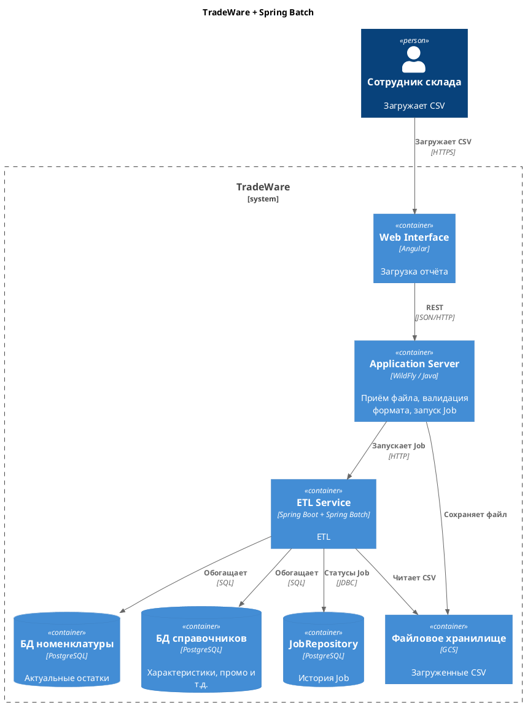

# Задание 4. Реализация ETL с использованием Spring Batch

## Варианты

| Вариант                         | Описание                                                                        | Преимущества                                       | Недостатки                                            |
| ------------------------------- | ------------------------------------------------------------------------------- | -------------------------------------------------- | ----------------------------------------------------- |
| Spring Batch (отдельный сервис) | ETL на Spring Batch в отдельном сервисе, запуск через JobLauncher               | Чанки, обработка ошибок, статусы, отдельный сервис | Нет удобного интерфейса для оркестрации из коробки    |
| Apache Airflow                  | DAG-оркестратор, интеграция с облаками                                          | Гибкие пайплайны, модули для облака                | Нужно изучать отдельный стек, сложно для одной задачи |
| Kubernetes CronJob              | Простая периодическая выгрузка, не event-driven, нет chunk-обработки из коробки | Простая настройка расписания                       | Не подходит для событийных ETL и обработки чанками    |
| Spring Cloud Data Flow (SCDF)   | Оркестрация Spring Batch, UI поверх Job                                         | Веб-интерфейс                                      | Лишняя сложность                                      |

## Принятое решение

Вариант 1 - отдельный Spring Boot сервис со Spring Batch.

- всего один ETL
- данные делятся на чанки, обработка на нодах
- запуск по расписанию

## Диаграмма

[c4_spring_batch.puml](c4_spring_batch.puml) / [c4_spring_batch.png](c4_spring_batch.png)

