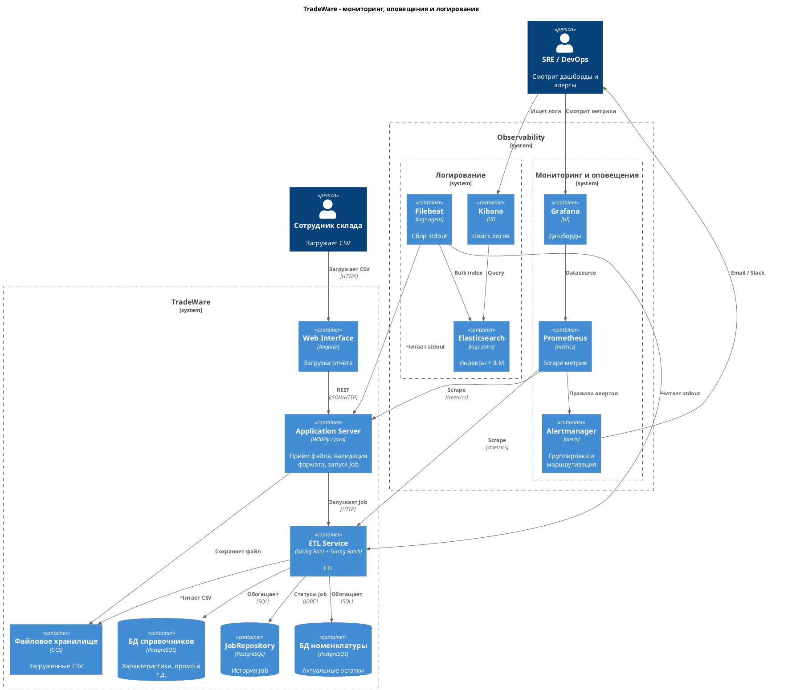

# Задание 5. Проектирование и реализация выбранных решений для мониторинга, оповещения и логирования

## Метрики

**ETL Service**

- Статус выполнения ETL-задач
- Соответствие времени выполнения SLA
- Пропускная способность (объём обработанных данных, скорость обработки)
- Количество ошибок и повторных запусков
- Качество данных (процент или количество отклонённых записей)

**Application Server**

Четыре золотых сигнала:

- latency
- traffic (RPS загрузок)
- error rate
- saturation (очередь)

**Инфраструктура (pod, PostgreSQL)**

USE:

- utilization CPU/RAM/Disk
- saturation (очереди)
- errors
 
## Данные для логов

1. Приложения пишут JSON-логи в stdout.
2. Filebeat забирает логи контейнеров и шлёт в Elasticsearch.

## Диаграмма

[c4_observability.puml](c4_observability.puml) / [c4_observability.png](c4_observability.png)

